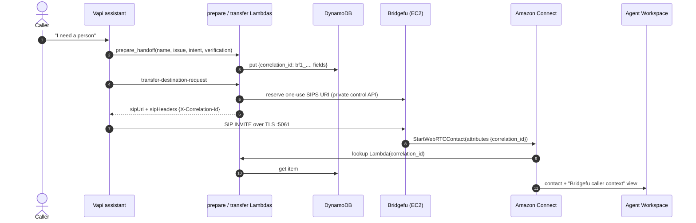

# 00 · Overview: what BridgeFu does and what this lab proves

## The problem in one paragraph

A Vapi voice assistant collects context (who the caller is, what they need, what
was verified). A plain SIP transfer to a contact center moves only the audio, so
the human agent starts from zero and the caller repeats everything. Amazon
Connect makes this worse: it does not expose arbitrary inbound SIP headers as
contact attributes, and it does not accept bring-your-own SIP trunks. BridgeFu
closes the gap. It is a Rust media gateway that terminates two call legs and
bridges audio, DTMF, and an explicitly allowed sliver of context between them.
For Amazon Connect it answers the Vapi SIP leg, calls `StartWebRTCContact` with
one contact attribute (`correlation_id`), and joins the resulting Chime WebRTC
session as the customer. A Lambda in the contact flow then looks that id up in
DynamoDB and the agent sees the fields before they say hello.

## The two flows this lab teaches



**Phone path (stages 1-4).** Exactly one header crosses the wire,
`X-Correlation-Id`. Everything else stays in DynamoDB inside the engineer's AWS
account and is fetched server-side. The dynamic transfer destination is a
`sip:<one-use-token>@<host>:5061;transport=tls` URI minted seconds before the
transfer, so the assistant never holds a reusable address.

```mermaid
sequenceDiagram
    autonumber
    actor Browser
    participant W as local demo server
    participant S as session Lambda (lab)
    participant B as Bridgefu (EC2)
    participant V as Vapi SIP assistant
    participant H as direct-handoff Lambda (released)
    participant C as Amazon Connect
    Browser->>W: POST /api/session
    W->>S: POST /v1/direct-session (lab bearer)
    S->>B: POST /v1/routes/vapi-direct-assistant/calls (ingress webrtc, handoff_token)
    S-->>Browser: one-use WebRTC attachment
    Browser->>B: WSS signaling + WebRTC media
    B->>V: SIP INVITE (X-Correlation-Id, X-Bridgefu_Handoff_Token)
    Browser->>V: conversation (audio bridged by Bridgefu)
    V->>H: bridgefu_direct_handoff(fields, {{bridgefu_handoff_token}})
    H->>B: POST /v1/calls/{call}/legs/{vapi}/replace {route_id: amazon-connect}
    B->>C: StartWebRTCContact(attributes {correlation_id})
    Note over Browser,C: browser RTCPeerConnection never drops; Vapi leg retired only after Connect media is up
```

**Browser path (stage 5).** Here BridgeFu is the browser's WebRTC server. It
dials the Vapi assistant over SIP on the caller's behalf, and when the assistant
decides to escalate, a trusted backend asks BridgeFu to *replace* the Vapi leg
with Amazon Connect. The replacement is make-before-break: Connect is set up
first, then the Vapi leg is retired; if Connect fails, the assistant resumes.
The browser sees the lifecycle over a reserved data channel
(`preparing -> ringing -> attaching -> connected`, or `resumed`/`failed`).

## What is proven, and by whom

| Claim | Evidence |
|---|---|
| Phone path works in production shape | Release 0.1.34 of `bridgefu-vapi-awsconnect` is live-qualified in both supported regions with signed evidence; this lab deploys that exact release. |
| Browser path works | The same release qualified `bridgefu-web-sdk-handoff` with the browser running on the CI runner through an SSM tunnel to the host. This lab exposes the same mechanism on a public TLS port so a laptop can use it. That last hop has not been qualified upstream. |
| Stock `@vapi-ai/web` browser call can transfer to SIP | Never proven. Both upstream repos say so explicitly. This lab does not depend on it. |

## Glossary

- **Correlation id**: `bf1_` plus 43 URL-safe characters, derived by HMAC from the Vapi call. It is the only thing on the wire and the only key in DynamoDB.
- **Wrapper flow**: the Connect flow BridgeFu enters first (`bridgefu-<id>-entry`). It runs the lookup Lambda, copies attributes, sets the agent-guide view, then transfers to *your* target flow.
- **Agent guide view**: a Connect `ShowView` titled "Bridgefu caller context" that Agent Workspace renders next to the contact. Agents need the `CustomViews.Access` and `Views.View` permissions to see it.
- **Screen-pop fields**: `customer_name`, `issue_summary`, `intent`, `verification_status`. Labels and choices can change; the keys should stay (see 07-troubleshooting).
- **Identity binding**: a Secrets Manager secret naming the one Vapi org and assistant the stack trusts. Everything else gets HTTP 403.
- **Overlay**: the lab's replacement `/etc/bridgefu/bridgefu.yaml` and `haproxy.cfg` that enable the browser path on the host; restored at teardown.

## How to run the lab

You need Node 22 or newer and the AWS CLI v2; nothing else is installed. Two
ways to drive the lab, both running the same commands:

- **Claude Code**: open this repository and ask it to run the BridgeFu lab; the
  skill in `.claude/skills/vapi-bridgefu-connect/` sequences the stages and
  confirms before anything that costs money or deletes resources.
- **Terminal**: run the stages directly:

```bash
node scripts/lab.mjs preflight --region us-west-2 --hosted-zone-id Z0123456789ABC --sip-hostname bridgefu-lab.example.com --create-vapi-secret
```

| Stage | Command | Doc | Typical time |
|---|---|---|---|
| 0 | `lab.mjs preflight` | this page | 1 min |
| 1 | `lab.mjs connect` | [01-amazon-connect.md](01-amazon-connect.md) | 5-10 min |
| 2 | `lab.mjs bridgefu` | [02-bridgefu-stack.md](02-bridgefu-stack.md) | 20-30 min |
| 3 | `lab.mjs vapi` | [03-vapi-wiring.md](03-vapi-wiring.md) | 2 min |
| 4 | call, then `lab.mjs verify-phone` | [04-phone-test.md](04-phone-test.md) | 5 min |
| 5 | `lab.mjs web-setup`, `lab.mjs web-serve`, `lab.mjs verify-web` | [05-web-sdk-handoff.md](05-web-sdk-handoff.md) | 15 min |
| 6 | `lab.mjs teardown` | [06-teardown.md](06-teardown.md) | 20-40 min |

Costs and limits are in [07-costs-and-limits.md](07-costs-and-limits.md); the
customer discovery checklist for FDEs is [08-scoping-checklist.md](08-scoping-checklist.md).
Engineers without AWS access run the AWS stages in a shared lab account
(CodeBuild, started through a gateway that checks their GitHub repository access): [09-remote-lab.md](09-remote-lab.md).
